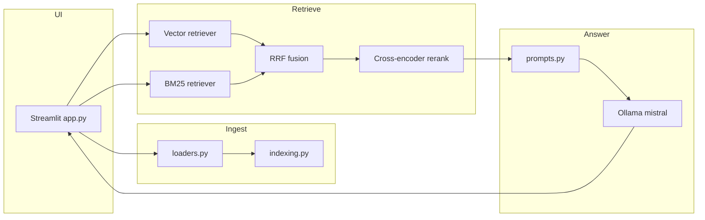

# Orbit Document Chatbot

**Private, local-first RAG over your files** — upload PDFs, Office docs, spreadsheets, or markdown, then chat with citations. Built with [Streamlit](https://streamlit.io), [LlamaIndex](https://www.llamaindex.ai), and [Ollama](https://ollama.com) so inference stays on your machine (no API keys required for the default setup).

> Portfolio project by [GrandhiPadmavathi](https://github.com/GrandhiPadmavathi). All sample documents use a fictional **OrbitMobile** brand — no real operator data.

## Why this exists

Most “chat with PDF” demos stop at vector search and hallucinate when context is thin. This app is meant to show production-minded RAG patterns: **hybrid retrieval**, optional **re-ranking**, **grounded answers with refusals**, **source citations**, and a small **evaluation harness** you can re-run locally.

## Features

| Feature | What you get |
|--------|----------------|
| **Citations** | Answers reference `[1]`, `[2]`; expandable source list with file name, PDF page (when available), and snippet |
| **Hybrid retrieval** | BM25 + dense vectors fused with **reciprocal rank fusion (RRF)** |
| **Re-ranking** | Optional cross-encoder (`cross-encoder/ms-marco-MiniLM-L-6-v2`); falls back gracefully if the model cannot download |
| **Grounded QA** | Prompt constrains answers to context; standard refusal: *“I could not find this in the documents”* |
| **Faithfulness badge** | Optional LLM judge toggle in the sidebar |
| **Disk cache** | Vector index persisted under `llamaindex_cache/` keyed by content hash |
| **Evals** | `evals/run_eval.py` compares vector-only vs hybrid vs hybrid+rerank on Hit@k, MRR, and answer checks |

## Architecture



## Quickstart (Windows / macOS / Linux)

1. **Install Ollama** and pull models:

   ```bash
   ollama pull mistral
   ollama pull nomic-embed-text
   ```

2. **Create a virtual environment** in the repo (recommended — avoids global package conflicts):

   ```bash
   cd llamaindex-document-chatbot
   python -m venv .venv
   .venv\Scripts\activate          # Windows
   # source .venv/bin/activate     # macOS/Linux
   pip install -r requirements.txt
   ```

3. **Optional:** copy `.env.example` to `.env` and adjust `OLLAMA_BASE_URL`, `LLM_MODEL`, `EMBED_MODEL`.

4. **Run the app:**

   ```bash
   streamlit run app.py
   ```

   Open http://localhost:8501

### Try sample documents

Fake telecom docs live in `sample_docs/`. Upload any of them in the sidebar, or run a CLI smoke test (requires Ollama):

```bash
python scripts/smoke_chat.py
```

## Sidebar settings

| Setting | Default | Purpose |
|---------|---------|---------|
| Chunk size / overlap | 600 / 100 | Sentence-aware splitting |
| Top K | 5 | Chunks passed to the LLM |
| Hybrid search | on | BM25 + vector + RRF |
| Cross-encoder re-rank | off | Precision boost; needs Hugging Face download |
| Temperature | 0.1 | LLM creativity |
| Faithfulness check | off | Extra LLM call; shows supported / unsupported badge |

## Evaluation

```bash
python evals/run_eval.py
```

Writes **`evals/results.md`** with real numbers from your machine (never hand-edited). Metrics:

- **Hit@k / MRR** — expected source file appears in top-k retrieved chunks
- **Answer accuracy** — key-fact substring match (or correct refusal for unanswerable questions)

### Latest local results

26 questions over the sample docs (24 answerable, 2 deliberately unanswerable), Mistral + nomic-embed-text on a CPU-only laptop, top_k = 5:

| Configuration | Hit@5 | MRR | Answer accuracy | Correct refusals (unanswerable) |
|---|---:|---:|---:|---:|
| Vector only | 0.923 | 0.878 | 1.000 | 2 / 2 |
| Hybrid (BM25 + vector, RRF) | 0.923 | 0.865 | 1.000 | 2 / 2 |
| Hybrid + cross-encoder re-rank | 0.923 | **0.923** | 0.962 | 1 / 2 |

What the numbers say:

- **Re-ranking puts the right source first more often** (MRR 0.878 → 0.923), but on one unanswerable question the extra-relevant-looking context led the model to answer instead of refusing. Better ranking does not automatically mean safer answers.
- **Hybrid search did not beat vector search here.** The sample questions are mostly paraphrase-friendly; BM25 earns its keep on exact codes, IDs and rare terms, which this set barely covers. Adding such questions is on the roadmap.
- The set is small, so treat differences of one question (≈ 0.04) as noise.

Full output: [evals/results.md](evals/results.md); per-configuration JSON in `evals/results/`.

## Tests

```bash
pytest
```

Unit tests cover loaders, chunking, RRF fusion, citations, and refusal behavior with a fake LLM (no Ollama required).

## Docker

See [docs/DEPLOY.md](docs/DEPLOY.md). Ollama typically runs on the **host**; the container points at `http://host.docker.internal:11434`.

## Screenshots / demo GIF

Place assets under `docs/images/` (not committed by default). To record a short demo:

1. Run `streamlit run app.py`.
2. Upload `sample_docs/prepaid_plans_faq.md`.
3. Ask: *“How much does Orbit Lite cost per month?”*
4. Use **Win+G** (Xbox Game Bar) or [ShareX](https://getsharex.com/) on Windows to capture the citation expander.

## Tech stack

Streamlit · LlamaIndex · Ollama (`mistral`, `nomic-embed-text`) · rank-bm25 · sentence-transformers (optional reranker) · pytest · reportlab (sample PDF)

## Roadmap

- [ ] Harder eval set: exact plan codes, IDs and rare terms where BM25 should help
- [ ] Multi-file corpus in one session
- [ ] Hosted embedding provider switch for HF Spaces
- [ ] Conversation memory with citation-aware follow-ups
- [ ] Export chat + sources to Markdown

## Project history

- **v1** — Streamlit + LlamaIndex + Ollama vector RAG with disk cache (`38c3a53`)
- **v2** — Citations, hybrid+RRF+rerank, grounded refusals, modular `chatbot/` package, evals, tests, Docker

## License

MIT — see [LICENSE](LICENSE).
