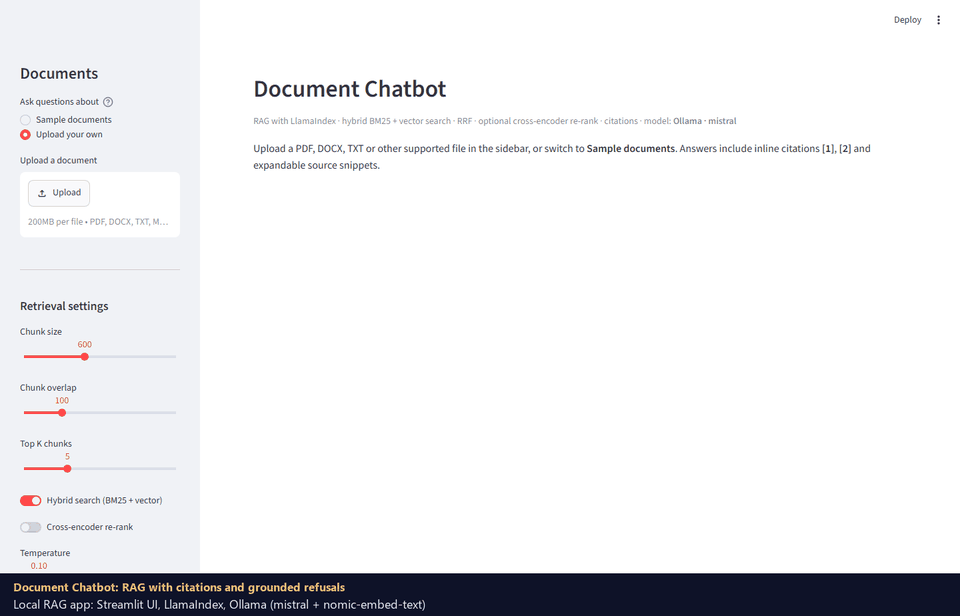
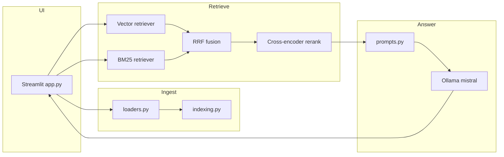

# Orbit Document Chatbot

**Private, local-first RAG over your files** — upload PDFs, Office docs, spreadsheets, or markdown, then chat with citations. Built with [Streamlit](https://streamlit.io), [LlamaIndex](https://www.llamaindex.ai), and [Ollama](https://ollama.com) so inference stays on your machine (no API keys required for the default setup).

> Portfolio project by [GrandhiPadmavathi](https://github.com/GrandhiPadmavathi). All sample documents use a fictional **OrbitMobile** brand — no real operator data.

## Demo



Recorded locally with `mistral` and `nomic-embed-text` on Ollama over the sample documents; model thinking time is
sped up. It asks about card refunds and eSIM QR codes (each answer cites its source, and the Sources panel shows the
exact snippets), then asks for a headquarters address that is not in any document, so the bot refuses instead of
inventing one.

## Why this exists

Most “chat with PDF” demos stop at vector search and hallucinate when context is thin. This app is meant to show production-minded RAG patterns: **hybrid retrieval**, optional **re-ranking**, **grounded answers with refusals**, **source citations**, and a small **evaluation harness** you can re-run locally.

## Features

| Feature | What you get |
|--------|----------------|
| **Citations** | Answers reference `[1]`, `[2]`; expandable source list with file name, PDF page (when available), and snippet |
| **Hybrid retrieval** | BM25 + dense vectors fused with **reciprocal rank fusion (RRF)** |
| **Re-ranking** | Optional cross-encoder (`cross-encoder/ms-marco-MiniLM-L-6-v2`); falls back gracefully if the model cannot download |
| **Grounded QA** | Prompt constrains answers to context; standard refusal: *“I could not find this in the documents”* |
| **Faithfulness badge** | Optional LLM judge toggle in the sidebar |
| **Disk cache** | Vector index persisted under `llamaindex_cache/` keyed by content hash |
| **Evals** | `evals/run_eval.py` compares vector-only vs hybrid vs hybrid+rerank on Hit@k, MRR, and answer checks |
| **Sign-in and roles** | Optional OIDC sign-in (Google, Entra ID, Okta...), reader / contributor / admin roles, per-user daily quotas, audit log; see [Security](#security) |

## Architecture



## Quickstart (Windows / macOS / Linux)

1. **Install Ollama** and pull models:

   ```bash
   ollama pull mistral
   ollama pull nomic-embed-text
   ```

2. **Create a virtual environment** in the repo (recommended — avoids global package conflicts):

   ```bash
   cd llamaindex-document-chatbot
   python -m venv .venv
   .venv\Scripts\activate          # Windows
   # source .venv/bin/activate     # macOS/Linux
   pip install -r requirements.txt
   ```

3. **Optional:** copy `.env.example` to `.env` and adjust `OLLAMA_BASE_URL`, `LLM_MODEL`, `EMBED_MODEL`.

4. **Run the app:**

   ```bash
   streamlit run app.py
   ```

   Open http://localhost:8501

### Try sample documents

Fake telecom docs live in `sample_docs/`. Upload any of them in the sidebar, or run a CLI smoke test (requires Ollama):

```bash
python scripts/smoke_chat.py
```

## Sidebar settings

| Setting | Default | Purpose |
|---------|---------|---------|
| Chunk size / overlap | 600 / 100 | Sentence-aware splitting |
| Top K | 5 | Chunks passed to the LLM |
| Hybrid search | on | BM25 + vector + RRF |
| Cross-encoder re-rank | off | Precision boost; needs Hugging Face download |
| Temperature | 0.1 | LLM creativity |
| Faithfulness check | off | Extra LLM call; shows supported / unsupported badge |

## Security

Run locally, the app is single-user and needs no sign-in. Shared or public deployments set `AUTH_REQUIRED=1` and an
OpenID Connect provider (setup in [docs/DEPLOY.md](docs/DEPLOY.md#sign-in-and-roles)); the app then shows nothing but
a sign-in button until the provider vouches for the user.

| Role | Who | Can |
|---|---|---|
| reader | anyone in `AUTH_ALLOWED` (an address or `@domain`; empty means any verified account) | ask questions about the sample documents |
| contributor | `AUTH_CONTRIBUTORS` | also upload documents and turn on re-rank and the faithfulness check, which cost extra model calls |
| admin | `AUTH_ADMINS` | also see today's usage per user |

- **Identity comes from the provider's signed token**, matched by exact address or exact domain (`@corp.example`
  does not match `evil-corp.example` or `corp.example.attacker.io`). Accounts the provider marks as unverified are
  refused.
- **Per-user daily quotas** for questions and uploads (`QUOTA_QUESTIONS_PER_DAY`, `QUOTA_UPLOADS_PER_DAY`) are kept
  server-side, so a page refresh or a new tab does not reset them, unlike the per-session limit of the anonymous demo.
- **Uploads stay in memory.** When sign-in or demo mode is on, an uploaded document is indexed for that browser
  session only and never written to the disk cache. Locally, the disk cache keeps working as before.
- **Fails closed.** With `AUTH_REQUIRED=1` but no provider configured, the app shows a configuration error.
- **Audit log** (`chatbot.audit`, JSON): sign-ins, refused accounts, uploads (name, size, content hash), questions
  (user, length, refused or not, citation count) and quota hits. Question text and document content are not logged.
- Secrets stay out of the repo: the OIDC client goes in the git-ignored `.streamlit/secrets.toml` (or Space
  secrets), and `scripts/deploy_space.py` never uploads that file.

`tests/test_access.py` checks the matching rules, roles, quotas and in-memory uploads, and drives the real app with a
simulated identity provider: signed-out users see only the sign-in button, refused accounts are audited, readers
cannot upload or use the costly settings, and a quota survives a new session. A further test checks that the Space
deploy never stages `secrets.toml`.

Not covered: per-user document libraries (uploads are per session), and quotas are per server process, so a
multi-replica deployment would need a shared store such as Redis.

## Evaluation

```bash
python evals/run_eval.py
```

Writes **`evals/results.md`** with real numbers from your machine (never hand-edited). Metrics:

- **Hit@k / MRR** — expected source file appears in top-k retrieved chunks
- **Answer accuracy** — key-fact substring match (or correct refusal for unanswerable questions)

### Latest local results

26 questions over the sample docs (24 answerable, 2 deliberately unanswerable), Mistral + nomic-embed-text on a CPU-only laptop, top_k = 5:

| Configuration | Hit@5 | MRR | Answer accuracy | Correct refusals (unanswerable) |
|---|---:|---:|---:|---:|
| Vector only | 0.923 | 0.878 | 1.000 | 2 / 2 |
| Hybrid (BM25 + vector, RRF) | 0.923 | 0.865 | 1.000 | 2 / 2 |
| Hybrid + cross-encoder re-rank | 0.923 | **0.923** | 0.962 | 1 / 2 |

What the numbers say:

- **Re-ranking puts the right source first more often** (MRR 0.878 → 0.923), but on one unanswerable question the extra-relevant-looking context led the model to answer instead of refusing. Better ranking does not automatically mean safer answers.
- **Hybrid search did not beat vector search here.** The sample questions are mostly paraphrase-friendly; BM25 earns its keep on exact codes, IDs and rare terms, which this set barely covers. Adding such questions is on the roadmap.
- The set is small, so treat differences of one question (≈ 0.04) as noise.

Full output: [evals/results.md](evals/results.md); per-configuration JSON in `evals/results/`.

## Tests

```bash
pytest
```

26 tests cover loaders, chunking, RRF fusion, citations, refusal behavior with a fake LLM, and sign-in, roles and
quotas (no Ollama or identity provider required). Two integration tests are marked `ollama` and `slow`.

## Docker

See [docs/DEPLOY.md](docs/DEPLOY.md). Ollama typically runs on the **host**; the container points at `http://host.docker.internal:11434`.

## Screenshots / demo GIF

Place assets under `docs/images/` (not committed by default). To record a short demo:

1. Run `streamlit run app.py`.
2. Upload `sample_docs/prepaid_plans_faq.md`.
3. Ask: *“How much does Orbit Lite cost per month?”*
4. Use **Win+G** (Xbox Game Bar) or [ShareX](https://getsharex.com/) on Windows to capture the citation expander.

## Tech stack

Streamlit · LlamaIndex · Ollama (`mistral`, `nomic-embed-text`) · rank-bm25 · sentence-transformers (optional reranker) · pytest · reportlab (sample PDF)

## Roadmap

- [ ] Harder eval set: exact plan codes, IDs and rare terms where BM25 should help
- [ ] Multi-file corpus in one session
- [ ] Hosted embedding provider switch for HF Spaces
- [ ] Conversation memory with citation-aware follow-ups
- [ ] Export chat + sources to Markdown

## Project history

- **v1** — Streamlit + LlamaIndex + Ollama vector RAG with disk cache (`38c3a53`)
- **v2** — Citations, hybrid+RRF+rerank, grounded refusals, modular `chatbot/` package, evals, tests, Docker

## License

MIT — see [LICENSE](LICENSE).
